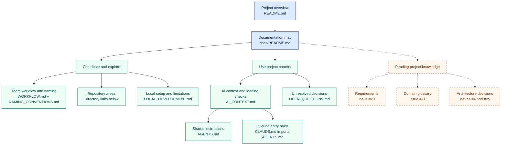

# Documentation map

This is the navigation hub for contributors and AI assistants. Start from a question below and follow the relevant links. The diagram is a reading map, not a runtime architecture diagram.

## Visual map

Solid arrows lead to documentation available in this draft. Dashed arrows lead to knowledge still pending in the backlog. Use the linked tables below the diagram to open each destination.

GitHub renders Mermaid in Markdown files. Editors without Mermaid support can use the text and links on this page. See [GitHub's diagram documentation](https://docs.github.com/en/get-started/writing-on-github/working-with-advanced-formatting/creating-diagrams).

## Reading paths

| Question | Read in this order |
| --- | --- |
| What are we building, and what exists today? | [Project overview](../README.md) -> [pending knowledge](#pending-knowledge) -> [open questions](OPEN_QUESTIONS.md) |
| How do I contribute? | [Workflow](WORKFLOW.md) -> [naming conventions](NAMING_CONVENTIONS.md) -> the relevant GitHub issue |
| Where does an area live? | [Directory table](#repository-areas) -> that area's README or source directory |
| How do I inspect or run the existing skeleton? | [Local development](LOCAL_DEVELOPMENT.md) -> [backend](../backend/README.md) or [mobile](../mobile/README.md) |
| How should an AI assistant begin? | [Shared instructions](../AGENTS.md) -> this map -> [AI context guide](AI_CONTEXT.md) -> task-specific sources |
| What is blocking an agreement? | [Open questions](OPEN_QUESTIONS.md) -> the linked issue or decision source |

## Repository areas

| Directory | Responsibility and current entry point |
| --- | --- |
| [`backend/`](../backend/README.md) | Spring Boot API skeleton; no business modules yet. |
| [`mobile/`](../mobile/README.md) | Flutter application skeleton with a connection-check screen. |
| [`web/`](../web/README.md) | Placeholder for the web application; technology choice remains open. |
| [`infrastructure/`](../infrastructure/README.md) | Placeholder for cloud infrastructure. Local Compose configuration is at the repository root. |
| [`scripts/`](../scripts/README.md) | Reserved for future helper scripts; no executable helpers are present. |
| [`docs/`](.) | Project knowledge, working agreements, setup notes, and open questions. |

## Pending knowledge

These documents have not yet been established in the repository. An issue title or a translated term is not an accepted product or architecture decision. Follow these issues rather than a link to a nonexistent document.

| Knowledge | Current source / delivery task |
| --- | --- |
| Owner requirements and scope priorities | [#20](https://github.com/studioforyou/zpi-studio/issues/20) |
| Agreed domain terminology | [#21](https://github.com/studioforyou/zpi-studio/issues/21) |
| Domain model and module boundaries | [#24](https://github.com/studioforyou/zpi-studio/issues/24) and [#31](https://github.com/studioforyou/zpi-studio/issues/31) |
| Architecture decision records | [#4](https://github.com/studioforyou/zpi-studio/issues/4) and [#25](https://github.com/studioforyou/zpi-studio/issues/25) |
| Repository workflow assistant specification | [#43](https://github.com/studioforyou/zpi-studio/issues/43); builds on this documentation work |

## Sources of truth

| Information | Authoritative source |
| --- | --- |
| Task scope, assignees, progress, and acceptance criteria | GitHub issues and their associated PRs |
| Implemented behavior | Versioned code/configuration and relevant verification evidence |
| Project overview and inspection baseline | [Root README](../README.md) |
| Contribution process | [WORKFLOW.md](WORKFLOW.md) |
| Language and naming rules | [NAMING_CONVENTIONS.md](NAMING_CONVENTIONS.md) |
| Instructions shared by AI tools | [AGENTS.md](../AGENTS.md); [AI_CONTEXT.md](AI_CONTEXT.md) explains loading and verification |
| Unresolved cross-cutting questions | [OPEN_QUESTIONS.md](OPEN_QUESTIONS.md), with links to the owning issues |
| Requirements, domain definitions, and architectural rationale | Their dedicated documents once accepted; until then use the tasks above and preserve their pending status |

If sources disagree, describe the conflict with links and avoid silently treating a proposal as an accepted decision. An issue marked complete is evidence of task status; it does not replace checking the relevant implementation or document.

## Keeping documentation current

- The author of a change updates affected documentation and navigation in the same PR. The reviewer checks the links and the consistency of the resulting guidance.
- Update the diagram and directory table together when navigation changes. Keep detailed rules in their owning document and link to them from other pages.
- For a decision record, use **Proposed**, **Accepted**, or **Superseded**. Include a date and a link to the discussion or review establishing that status. Keep implementation status separate.
- Until a proposal is reviewed through the team workflow, describe it as proposed. Do not infer acceptance from an issue assignment, a chat summary, or code already using a technology.
- Record missing decisions in the open-questions register, with a responsible role, source, impact, and next resolution step. Keep active work and assignments in GitHub rather than copying the board into Markdown.
- When an answer is agreed, update its authoritative document, link the evidence from the question, and update affected navigation in the same PR.
- Check relative links, referenced paths, diagram rendering, and whether setup instructions accurately describe what was verified. A documentation-only change does not require pretending that application tests were run.
